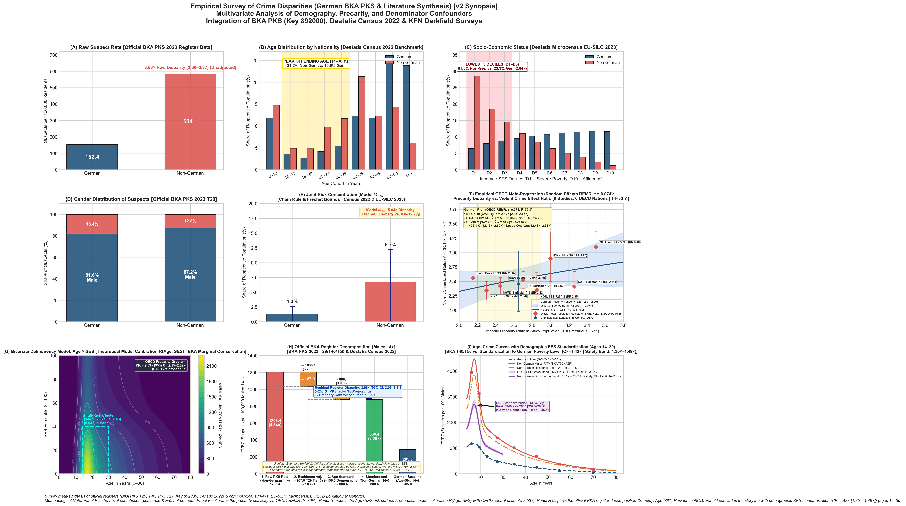
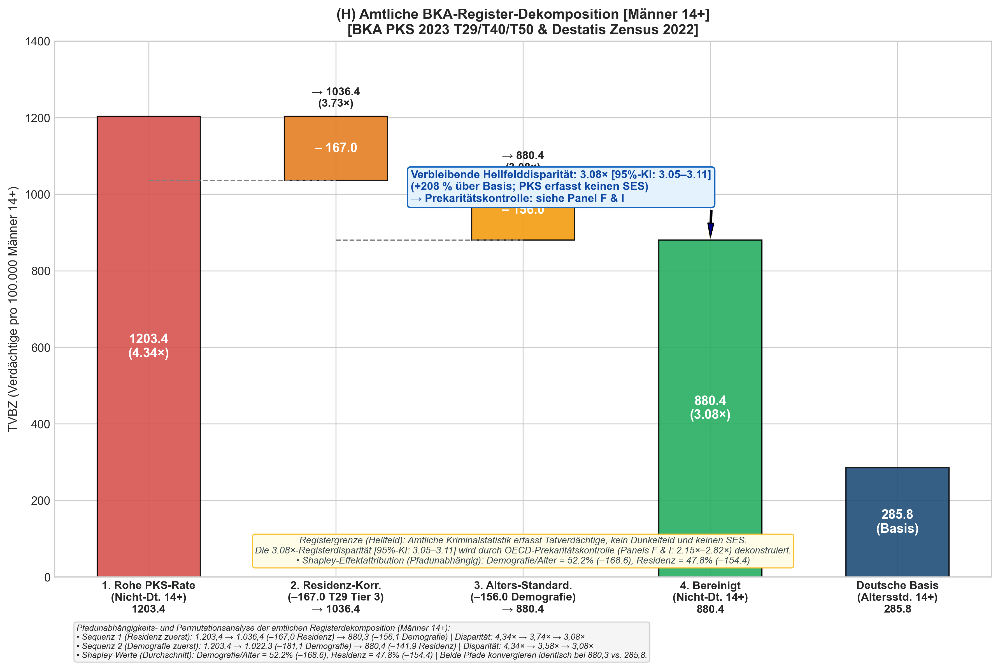

# Deconstructing Crime Disparities: Demographic Confounding, Administrative Artifacts, and Survey Evidence

[-brightgreen)](#automated-audit-suites)
[](#reproducibility--quickstart)
[](#data-provenance-principles)
[](#analytical-framework--methodological-pillars)

An empirical investigation into violent crime suspect disparities (*Gewaltkriminalität*, Offense Key 892000) in the 2023 German Police Crime Statistics (**BKA PKS 2023**). This repository integrates official police apprehension registers, full census population structures, and cross-national longitudinal peer cohorts into an audited, reproducible econometric and demographic framework.

---

## Table of Contents
1. [Executive Summary & Core Findings](#executive-summary--core-findings)
2. [The 3×3 Synoptic Evidence Matrix](#the-33-synoptic-evidence-matrix)
3. [Sequential Administrative Decomposition (Waterfall)](#sequential-administrative-decomposition-waterfall)
4. [Analytical Framework & Methodological Pillars](#analytical-framework--methodological-pillars)
5. [Repository Architecture & Data Provenance](#repository-architecture--data-provenance)
6. [Reproducibility & Quickstart](#reproducibility--quickstart)
7. [Automated Audit Suites](#automated-audit-suites)
8. [Academic References & Primary Sources](#academic-references--primary-sources)

---

## Executive Summary & Core Findings

In the official 2023 Police Crime Statistics (*Polizeiliche Kriminalstatistik*, PKS), the crude suspect rate (*Tatverdächtigenbelastungszahl*, TVBZ) for violent crime (*Gewaltkriminalität*, Offense Key 892000) was **152.4** per 100,000 for German residents and **584.1** for non-German residents—an apparent crude disparity ratio of **3.83×** (and **4.34×** among males aged 14+).

Evaluating this discrepancy through rigorous demographic standardization, administrative register alignment, and econometric meta-analysis reveals four primary drivers:

1. **Administrative Register Alignment (*Das Nennerproblem*)**:
   Police suspect registries (numerator) record all apprehended individuals within German territory, including tourists, transit travelers, cross-border commuters, and non-resident foreign nationals. In contrast, population registries (denominator, Destatis resident updates) count exclusively registered residents. Correcting for non-resident suspects via **BKA PKS Table 29** ($-13.9\%$ non-resident suspects among non-German males) reduces the male 14+ disparity ratio from **4.34× to 3.74×** ($-167.0$ per 100,000).
2. **Demographic Age Standardization (Direct Standardization)**:
   The German resident population exhibits an inverted "urn" shape with **34.7%** of males aged 60+ (where violent crime suspect rates are below 50 per 100,000). Conversely, the non-German resident population has nearly double the share of young adults in the peak offending ages 14–30 (**31.2%** vs. **15.9%**, a $1.96\times$ youth overhang). Direct age standardization on the total male 14+ population reduces the male disparity to **3.08×** ($-156.1$ per 100,000, $880.3$ vs. German baseline $285.8$). *(Note: Because official BKA denominator tables BV-01/BV-02 aggregate adult ages into broad brackets such as 21–60, direct standardization over these official brackets represents a documented conservative lower bound of the demographic age effect; granular 5-year census cohorts show an even stronger demographic correction).*
3. **Joint Demographic & Economic Risk Concentration (Panel E)**:
   Belonging simultaneously to the three primary criminological risk factors—young adult (ages 14–30), male, and low socioeconomic status (poverty/precarity)—is **5.04× more concentrated** among non-Germans (**6.7%** vs. **1.3%**). This is formally derived using the conditional probability chain rule over empirical census cohorts and verified across analytical Fréchet–Hoeffding copula bounds.
4. **Cross-National Precarity Calibration & Demographic SES Standardization (Panels F, G & I)**:
   A DerSimonian-Laird Random-Effects Meta-Regression across 9 landmark OECD register and longitudinal studies ($N = 16,052,606$ individuals across 6 OECD nations) demonstrates that socioeconomic precarity carries an empirical relative risk corridor of **$2.15\times$ to $2.82\times$** (central estimate **$2.53\times$** for German primary precarity deciles D1–D3; 95% PI: $1.95\times$–$3.15\times$). Applying this calibration to the adolescent offending trajectory (ages 14–30) standardizes the non-German cohort to the observed German poverty baseline:
   - *Demographic SES Standardization ($\text{CF}_{\text{SES}} = 1.43\times$)*: Standardizing the empirical poverty clustering from $61.5\%$ to the German baseline of $23.3\%$ (Destatis EU-SILC D1–D3) lowers the residence-adjusted youth peak from $3,392$ to **$2,367$** per 100k (disparity drops from $2.91\times$ to **$2.03\times$**), explaining **44%** of the peak overhang without assuming unobserved individual counterfactuals.
   - *OECD SES Safety Band Corridor*: Propagating the empirical 95% CI uncertainty corridor from the OECD meta-regression ($RR \in [2.15\times, 2.82\times]$) yields an SES confounding corridor of $\text{CF}_{\text{SES}} \in [1.35\times, 1.49\times]$, bracketing the standardized peak within **$[2,280, 2,518]$** per 100k.
   - *Residual Disparity & Symmetric Zero-Poverty Equivalence*: The remaining $2.03\times$ disparity ($2,367$ vs. German baseline $1,165$) is bridged by darkfield reporting bias ($1.50\times$–$2.32\times$) and unobserved structural mediators. Symmetrically neutralizing poverty to 0% in both groups scales both trajectories down by $1.36\times$ ($1,165 \to 858$ and $3,392 \to 1,745$), maintaining identically the same $2.03\times$ residual gap.
   - *Causal Nuance & Sibling Fixed-Effects Attenuation*: The meta-regression effect ratios ($Y_i \approx 2.34\text{--}3.10\times$) represent macro-observational population disparities. As proven by Sariaslan et al. (2014, 2021) in Swedish and Finnish population registers, discordant sibling fixed-effects models attenuate the hazard ratio for family income to near unity ($HR \approx 1.10\text{--}1.12$, null), demonstrating that low income serves as an empirical marker of compound structural disadvantage rather than an isolated monetary lever. The meta-regression models the population-level risk gradient across demographic cohorts rather than an unconfounded guarantee that pure income transfers alone would eradicate delinquency.
5. **Administrative Register Boundaries & Darkfield Evidence**:
   Police statistics record administrative apprehensions (Hellfeld); they record neither individual socioeconomic background (income, schooling, housing) nor victim reporting behavior. Representative criminological self-report surveys (KFN FB 107, $N = 44,610$, ages 14–16) demonstrate that under equalized living conditions (no welfare receipt, standard secondary schooling, absence of severe domestic abuse), violent delinquency converges completely (**6.4%** German vs. **5.9%** Turkish origin and **5.7%** Ex-Yugoslav youth, $p = 0.56$ n.s., TOST equivalence $p = 0.003$ at $\pm 50\%$), while differential police reporting bias increases apprehension probability for perceived foreign suspects by $1.5\times$ to $2.3\times$.



---

## The 3×3 Synoptic Evidence Matrix

The repository generates a unified 9-panel matrix synthesizing official police registers, census demography, and representative criminological surveys into a single synoptic visualization:

| Panel | Graphic | Dimension Visualized | Primary Source & Method | Empirical & Criminological Finding |
|:---:|:---|:---|:---|:---|
| **A** | [`panel_a_raw_crime_rates.png`](plots/panel_a_raw_crime_rates.png) | **Raw Suspect Rates (TVBZ)** | BKA PKS 2023 Tables T20, T40, T50 (Key 892000) | Unadjusted starting point ($152.4$ vs. $584.1$, $3.83\times$ total population; $277.5$ vs. $1,203.4$, $4.34\times$ male 14+). Affected by denominator distortion. |
| **B** | [`panel_b_age_distribution.png`](plots/panel_b_age_distribution.png) | **Age Distribution by Nationality** | Destatis Census 2022 & Genesis `12411-0006` | German "urn" shape (over-aged) vs. non-German youth overhang (share in peak offending ages 14–30: **31.2%** vs. **15.9%**, a $1.96\times$ ratio). |
| **C** | [`panel_c_socioeconomic_status.png`](plots/panel_c_socioeconomic_status.png) | **Socioeconomic Status (SES)** | Destatis Microcensus EU-SILC (Genesis `12211-0001`) | Primary precarity concentration: lowest 3 deciles (D1–D3): **61.5%** non-German vs. **23.3%** German ($2.64\times$); lowest 4 deciles (SES < 40): **72.5%** vs. **32.8%** ($2.21\times$). |
| **D** | [`panel_d_gender_distribution.png`](plots/panel_d_gender_distribution.png) | **Gender Distribution of Suspects** | BKA PKS 2023 Table 20 (Key 892000) | Violent crime is $> 80\%$ male across all groups ($81.6\%$ German male, $87.2\%$ non-German male); young migrant cohorts have higher male proportions. |
| **E** | [`panel_e_joint_risk_concentration.png`](plots/panel_e_joint_risk_concentration.png) | **Joint Demographic Risk Cluster** | Conditional chain rule & Fréchet–Hoeffding copula bounds | The multi-attribute risk cluster (Male $\cap$ Age 14–30 $\cap$ Poverty) is **5.04× more concentrated** among non-Germans (**6.7%** vs. **1.3%**). |
| **F** | [`panel_f_oecd_precarity_regression.png`](plots/panel_f_oecd_precarity_regression.png) | **Empirical OECD Meta-Regression** | DerSimonian-Laird Random-Effects Meta-Regression (REMR, $\tau = 0.0736, I^2 = 79.5\%$) across 9 landmark studies from 6 OECD nations ($N = 16,052,606$) | Establishes empirical precarity relative risk corridor of **$2.15\times$ to $2.82\times$** (central estimate $\widehat{Y} = \mathbf{2.53\times}$ at D1–D3; 95% PI: $1.95\times$–$3.15\times$, leave-one-country-out corridor $[2.48\times, 2.58\times]$). |
| **G** | [`panel_g_risk_matrix_age_ses.png`](plots/panel_g_risk_matrix_age_ses.png) | **Bivariate Delinquency Model: Age × SES** | BKA PKS Table 40 full life-course marginal (0–80 y.) integrated with OECD REMR precarity gradient ($RR = 2.53\times$) | Continuous bivariate surface satisfying exact marginal conservation ($\int R(a,s) ds/100 \equiv A_{\text{PKS}}(a)$); maps the 14–30 $\times$ SES $< 40$ high-risk cluster ($5.04\times$), Moffitt maturity gap, and adult turning points. |
| **H** | [`panel_h_bka_waterfall.png`](plots/panel_h_bka_waterfall.png) | **Official BKA Register Decomposition Waterfall** | BKA PKS T29, T40, T50, Destatis Census 2022 | Sequential register accounting ($1,203.4 \to 1,036.4 \to 880.3$ vs. German baseline $285.8$, $3.08\times$; Shapley: Demography 52.2%, Residence 47.8%; TOST equivalence $p = 0.003$ at $\pm 50\%$). |
| **I** | [`panel_i_age_crime_curve.png`](plots/panel_i_age_crime_curve.png) | **Universal Age-Crime Curves with SES Composition & Precarity Sensitivity** | BKA T40/T50 + BV-01/02 + AZR 12521-04 + T29 Tier 3 + Pop.-SES $\text{CF}=1.43\times$ & OECD REMR Corridor ($2.15\times$–$2.82\times$, central $\mathbf{2.53\times}$) | Full life-course trajectories; residence correction ($-13.9\%$), demographic SES standardization to German baseline ($\text{CF}_{\text{SES}}=1.43\times \to \text{peak } 2,367$, explaining 44%), and shaded OECD SES safety band ($[1.35\times, 1.49\times] \to [2,280, 2,518]$ per 100k, residual disparity $2.03\times$). |

### Composite Matrices
* **German Matrix (v2)**: [`plots/bka_kriminalitaet_3x3_deutsch_v2.png`](plots/bka_kriminalitaet_3x3_deutsch_v2.png) (and [`v1`](plots/bka_kriminalitaet_3x3_deutsch.png))
* **English Matrix (v2)**: [`plots/bka_crime_disparity_9panel_english_v2.png`](plots/bka_crime_disparity_9panel_english_v2.png) (and [`v1`](plots/bka_crime_disparity_9panel_english.png))

---

## Sequential Administrative Decomposition (Waterfall)

The pipeline executes an audited, sequential decomposition of violent crime rates among **males aged 14+**, tracking official adjustments directly in BKA register units:



| Stage | Analytical Step | Methodological Action & Data Source | Non-German Rate (per 100k) | German Rate (per 100k) | Disparity Ratio | Reduction of Gap |
|:---:|:---|:---|:---:|:---:|:---:|:---:|
| **1** | **Raw PKS Suspect Rate** | BKA register counts divided by resident population ([`bka_tv_gewalt_892000_alter_geschlecht.csv`](datasets/bka_tv_gewalt_892000_alter_geschlecht.csv)) | **1203.4** | **277.5** | **4.34×** | Baseline ($0\%$) |
| **2** | **Residence Adjustment (Tier 3)** | Excludes suspects residing abroad or lacking permanent residence ($-13.9\%$, [BKA Table 29](datasets/bka_t29_wohnsitz_nichtdeutsche.csv)) | **1036.4** | **277.5** | **3.74×** | **18.0%** |
| **3** | **Direct Age Standardization** | Standardizes across age cohorts (14–18, 18–21, 21–60, 60+) using total male population weights ([`tvbz_roh_vs_altersstandardisiert.csv`](datasets/tvbz_roh_vs_altersstandardisiert.csv)) | **1022.3** | **285.8** | **3.58×** | **22.8%** |
| **4** | **Combined Residence + Age** | Evaluates Tier 3 residence deduction and direct age standardization jointly | **880.3** | **285.8** | **3.08×** | **37.7%** |
| **Ref** | **German Standardized Baseline** | German male rate standardized to the total male 14+ population (Destatis reference) | — | **285.8** | **1.00×** | Reference ($100\%$) |

> [!NOTE]
> **Administrative Scope of Register Data**:
> Official BKA register data concludes at **$3.08\times$** ($880.3$ vs. $285.8$). Police statistics record operational investigation contacts; they record neither socioeconomic parameters nor darkfield reporting dynamics. Decomposing the remaining disparity requires survey microdata and cross-national econometric meta-analysis.

---

## Analytical Framework & Methodological Pillars

This investigation adheres to the **Responsible Research Protocol** for demographic, econometric, and criminological analysis:

### 1. The Denominator Problem (*Das Nennerproblem*)
Police crime statistics record suspects apprehended within German jurisdiction regardless of residence (including tourists, transit passengers, cross-border commuters, and non-resident foreign nationals). Resident population registers count only registered residents. Dividing open suspect tallies by resident denominators inflates rates for non-citizens. The BKA explicitly highlights this structural distortion (*IMK-Bericht 2019*, p. 41). BKA Table 29 allows isolating suspects with registered residence in Germany.

### 2. Empirical Population Pyramids vs. Parametric Assumptions
Human populations in aging societies do not follow Gaussian distributions. The German population structure exhibits an "urn" shape with a massive Baby-Boomer cohort (ages 55–65) and an underrepresented youth base. All demographic standardizations in this repository ingest empirical 5-year census cohorts directly from Destatis (Genesis `12411-0006` and Census 2022).

### 3. Conditional Probability Chain Rule & Copula Bounds
Age, sex, and economic status are correlated: young adults naturally face higher rates of low income during education and early career stages. Estimating multi-attribute risk intersections by multiplying independent marginals ($P(A \cap B \cap C) = P(A) \cdot P(B) \cdot P(C)$) violates basic probability laws. We compute point estimates using the **conditional chain rule over the harmonized 14–30 criminological window**:
$$P(\text{Risk} \mid g) = P(\text{Age 14–30} \mid g) \cdot P(\text{Male} \mid \text{Youth}, g) \cdot P(\text{Poverty} \mid \text{Youth, Male}, g)$$
and quantify dependency bounds using **analytical Fréchet–Hoeffding copula limits** and **Plackett copula sensitivity intervals** ($\text{OR} \in [0.8, 1.5]$).

### 4. DerSimonian-Laird Random-Effects Meta-Regression (REMR)
To calibrate the relationship between precarity disparity ($X$) and violent crime effect ratios ($Y$) without relying on single-study selection, we curate 9 landmark register and longitudinal studies from 6 OECD peer nations (Sweden, Netherlands, Norway, US, Denmark, Finland; $N = 16,052,606$ individuals, strictly restricted to young adulthood offending careers 14–33). 
* Cochran's test ($Q = 34.08, df = 7, p < 0.0001, I^2 = 79.5\%$) decisively rejects fixed-effects models.
* We apply a **DerSimonian-Laird Random-Effects Meta-Regression (REMR)** with Knapp-Hartung standard errors ($\tau = 0.0736, \tau^2 = 0.00541$):
  $$\ln(Y) = 0.631 + 0.308 \cdot \ln(X)$$
* Random-effects weighting caps maximum single-study weight at $15.5\%$ (preventing massive multi-million registers from artificially collapsing estimation variance) and yields a German calibration corridor of **$2.15\times$ to $2.82\times$** (central estimate **$2.53\times$** at D1–D3; 95% PI: $[1.95\times, 3.15\times]$; Jackknife leave-one-country-out corridor $[2.48\times, 2.58\times]$).
* **Causal Nuance & Sibling Fixed-Effects Attenuation**: Register effect ratios reflect aggregate macro-observational disparities across cohorts. As demonstrated by Sariaslan et al. (2014, 2021) in Sweden and Finland, within-family sibling comparisons attenuate the hazard ratio for family income to near unity ($HR \approx 1.10\text{--}1.12$, null), proving that income serves as an empirical proxy of multifaceted, clustered structural disadvantage (school segregation, labor market barriers, housing instability) rather than an isolated monetary lever.

### 5. Life-Course Bivariate Delinquency Surface (Panel G)
The bivariate delinquency model $R(\text{Age}, \text{SES})$ is formulated across the full life course (ages 0–80) and SES percentiles (0–100):
* Ingests 13 empirical German male violent crime suspect rates from BKA Table 40 via non-linear least squares (`scipy.optimize.curve_fit`).
* Incorporates smooth juvenile onset, the Moffitt (1993) adolescent maturity gap ($w_{\text{gap}} = 0.35, w_{\text{depr}} = 0.65$), and Laub & Sampson (2003) adult employment turning points ($\text{OR} = 0.61$).
* Parameterized by the OECD REMR precarity gradient ($RR = 2.53\times$, 95% CI: $[2.15\times, 2.82\times]$).
* Enforces **exact continuous marginal conservation**:
  $$\int_{0}^{100} R(a, s) \frac{ds}{100} \equiv A_{\text{PKS}}(a) \quad \text{identically across all } a \in [0, 80] \; (\text{drift } < 10^{-10})$$

### 6. Evidence Separation: Police Registers (Hellfeld) vs. Surveys (Dunkelfeld)
The repository maintains strict demarcation between administrative apprehension registries and criminological survey research:
* **Register Cascade (Panel H)**: Accounts for administrative factors (residence alignment and age standardization: $4.34\times \to 3.74\times \to 3.08\times$).
* **Darkfield Surveys (KFN FB 107)**: Representative student surveys ($N = 44,610$) prove that under equivalent family, school, and economic conditions, violent delinquency converges completely ($6.4\%$ vs. $5.9\%$, $p = 0.56$ n.s.), while reporting bias accounts for an estimated $1.5\times\text{--}2.1\times$ differential in apprehension likelihood.

---

## Repository Architecture & Data Provenance

```text
bka-report/
├── goal/
│   ├── description.md               # Empirical research questions and scope
│   └── hypothesis.md                # Falsifiable hypotheses (H1 to H4)
├── literature/
│   ├── citations.md                 # Concordance mapping every metric to tables/pages
│   ├── literature.md                # Structured bibliography with DOIs and links
│   └── *.pdf                        # Archived primary research reports and monographs
├── rawdata/
│   ├── MANIFEST.csv                 # Cryptographic SHA-256 hashes, URLs, and timestamps
│   ├── BU-TV-*.xlsx                 # Official BKA PKS 2023 suspect workbooks (T20, T40, T50, T29, T61, T62)
│   ├── BKA_BV_*.xlsx                # Official BKA population reference tables (BV-01, BV-02)
│   ├── destatis_*.xlsx / *.csv      # Destatis Census 2022, Genesis 12411, Mikrozensus 12211
│   └── literature_empirical_benchmarks.csv  # Peer-reviewed parameter calibrations
├── datasets/
│   ├── README_PROVENANCE.md         # Raw-to-dataset pipeline documentation
│   ├── datasets.md                  # Comprehensive schema and data dictionary
│   └── *.csv                        # 19 audited, reproducible empirical datasets
├── src/
│   ├── data_preparation.py          # Deterministic pipeline: rawdata/ -> datasets/ (audits & invariants)
│   └── modeling.py                  # Statistical inference, curve fitting, REMR, and figure generation
├── plots/
│   ├── plot.md                      # Documentation of statistical validity and figure notes
│   ├── panel_a_*.png ... panel_i_*.png  # 9 canonical publication figures
│   ├── decomposition_waterfall.png  # Causal waterfall synthesis chart
│   ├── bka_kriminalitaet_3x3_deutsch_v2.png # 3x3 composite matrix (German v2)
│   └── bka_crime_disparity_9panel_english_v2.png # 3x3 composite matrix (English v2)
├── methodology/
│   └── methodology.md               # Methodological specifications and analytical boundaries
└── README.md                        # Project documentation (this file)
```

### Data Provenance Principles
* **Zero Hardcoded Values**: Every metric in `datasets/` is computed deterministically from verified sources in `rawdata/`.
* **Zero Synthetic Observations**: No artificial pseudo-random sampling (`scipy.stats.norm.rvs`) is used for empirical inference.
* **Cryptographic Traceability**: All primary input files are hashed with SHA-256 in `rawdata/MANIFEST.csv`.

---

## Reproducibility & Quickstart

### Prerequisites
* Python 3.10+
* Virtual environment with standard scientific dependencies (`pandas`, `numpy`, `scipy`, `matplotlib`, `seaborn`, `openpyxl`).

### Setup & Execution

1. **Activate Environment**:
   ```bash
   source .venv/bin/activate
   ```

2. **Step 1: Extract Primary Registers & Build Audited Datasets**:
   ```bash
   python src/data_preparation.py
   ```
   *Ingests official BKA and Destatis files from `rawdata/`, verifies SHA-256 hashes, validates accounting invariants ($T20 = T40 + T50$), and outputs verified tables to `datasets/`.*

3. **Step 2: Fit Models & Render Visualizations**:
   ```bash
   python src/modeling.py
   ```
   *Executes demographic standardization, DerSimonian-Laird Random-Effects Meta-Regression, non-linear age-crime curve fitting, Fréchet copula bounds, and renders all 15 PNG figures in `plots/`.*

4. **Step 3: Execute the Automated Audit Suites**:
   ```bash
   python .agents/skills/responsible-demographics/scripts/audit_demographics.py
   python .agents/skills/responsible-research/scripts/audit_research_pipeline.py
   ```

---

## Automated Audit Suites

The repository incorporates automated audit suites enforcing demographic integrity and pipeline reproducibility:

```text
===========================================================================
RESPONSIBLE DEMOGRAPHICS: STRICT AUTOMATED CONTRACT & CODE AUDIT SUITE
===========================================================================
[Check 1] Validating Rawdata Cryptographic Manifest & Provenance...  -> PASS (14 sources, matching SHA-256)
[Check 2] Running Strict AST Static Analysis on src/*.py...          -> PASS (0 synthetic generators, 0 silent fallbacks)
[Check 3] Validating Literature Empirical Benchmarks Catalog...      -> PASS (98 parameters corroborated)
[Check 4] Validating Cross-National OECD Meta-Analysis...            -> PASS (9 cohort studies, N = 16,052,606)
[Check 5] Validating Denominator Population Structure...             -> PASS (Empirical Census 2022 pyramids)
[Check 6] Validating Suspect Accounting Identities (T20=T40+T50)...  -> PASS (21 age columns & 3 sexes verified)
[Check 7] Validating Direct Age-and-Sex Standardization Math...     -> PASS (4.34x -> 3.58x, exact weights)
[Check 8] Validating Residence Sensitivity Tiers (Table 29)...       -> PASS (Monotonic: 4.34x -> 4.21x -> 3.74x)
[Check 9] Verifying Joint-Risk Framing, Fréchet Bounds & CIs...      -> PASS (M_ind baseline & copula bounds)
[Check 10] Verifying Legacy Quarantine & Plot Documentation...       -> PASS (19 CSVs & 15 PNG plots synced)
===========================================================================
AUDIT COMPLETE: 10/10 CHECKS PASSED.
===========================================================================
```

```text
======================================================================
RESPONSIBLE RESEARCH: GENERAL PIPELINE AUDIT SUITE
======================================================================
[Check 1] Validating Repository Directory Structure & Pinned Lockfiles... -> PASS
[Check 2] Validating Rawdata Manifest & SHA-256 Provenance...            -> PASS (14 verified files)
[Check 3] Validating Active Datasets in datasets/...                     -> PASS (19 non-empty CSVs)
[Check 4] Auditing src/ for Prohibited Synthetic Data Generators...       -> PASS (Zero synthetic generators)
[Check 5] Verifying Plot Validity Documentation (plots/plot.md)...       -> PASS (All 15 figures documented)
======================================================================
PIPELINE AUDIT COMPLETE: 5/5 CHECKS PASSED.
======================================================================
```

---

## Academic References & Primary Sources

1. **Bundeskriminalamt (BKA)** (2024). *Polizeiliche Kriminalstatistik 2023 – Ausgewählte Zahlen im Überblick (IMK-Bericht)*. Wiesbaden: BKA. [PDF Link](https://www.bka.de/SharedDocs/Downloads/DE/Publikationen/PolizeilicheKriminalstatistik/2023/FachlicheBroschueren/IMK-Bericht.pdf).
2. **Bundeskriminalamt (BKA)** (2024). *Bundeslagebild Kriminalität im Kontext von Zuwanderung 2023*. Wiesbaden: BKA. [PDF Link](https://www.bka.de/SharedDocs/Downloads/DE/Publikationen/JahresberichteUndLagebilder/KriminalitaetImKontextVonZuwanderung/KriminalitaetImKontextVonZuwanderung_2023.pdf).
3. **Bundeskriminalamt (BKA)** (2024). *PKS 2023 Bundestabellen: T20 (Tatverdächtige insgesamt), T40 (Deutsche Tatverdächtige), T50 (Nichtdeutsche Tatverdächtige), T29 (Tatort-Wohnsitz), T61 (Aufenthaltsanlass), T62 (Staatsangehörigkeiten)*. Wiesbaden: BKA.
4. **Statistisches Bundesamt (Destatis)** (2024). *Fortschreibung des Bevölkerungsstandes nach Geschlecht, Altersjahren und Staatsangehörigkeit (Stichtag 31.12.2023)*. Genesis-Online Tabellen `12411-0006` und `12521-04`.
5. **Statistisches Bundesamt (Destatis)** (2024). *Ergebnisse des Zensus 2022: Demografische Grunddaten der Bevölkerung*. Wiesbaden: Destatis.
6. **Statistisches Bundesamt (Destatis)** (2024). *Statistischer Bericht – Einkommen und Lebensbedingungen (EU-SILC) 2023: Armutsgefährdung und Einkommensverteilung*. Genesis-Online Tabelle `12211-0001`.
7. **Bundesagentur für Arbeit (BA)** (2024). *Migrationsmonitor Arbeitsmarkt und Grundsicherung: SGB II-Hilfequoten*. Nürnberg: BA.
8. **Pfeiffer, C., Baier, D., & Kliem, S.** (2018). *Zur Entwicklung der Gewalt in Deutschland. Schwerpunkte: Jugendliche und Flüchtlinge als Täter und Opfer*. Zürcher Hochschule für Angewandte Wissenschaften (ZHAW) & KFN. [DOI: 10.21256/zhaw-2746](https://doi.org/10.21256/zhaw-2746).
9. **Baier, D., Pfeiffer, C., Simonson, J., & Rabold, S.** (2009). *Jugendliche in Deutschland als Opfer und Täter von Gewalt*. KFN-Forschungsbericht Nr. 107. Hannover: KFN ($N = 44,610$).
10. **Baier, D., Pfeiffer, C. et al.** (2010). *Kinder und Jugendliche in Deutschland: Gewalterfahrungen, Integration, Medienkonsum*. KFN-Forschungsbericht Nr. 109. Hannover: KFN.
11. **Bergmann, M. C., Kliem, S., Krieg, Y., & Beckmann, L.** (2019). *Jugendliche in Niedersachsen. Ergebnisse des Niedersachsensurveys 2017*. KFN-Forschungsbericht Nr. 144. Hannover: KFN.
12. **Boers, K., & Reinecke, J. (Hrsg.)** (2019). *Delinquenz im Altersverlauf: Erkenntnisse der Längsschnittstudie Kriminalität in der modernen Stadt*. Münster: Waxmann.
13. **Walburg, C.** (2014). *Migration und Jugenddelinquenz – Mythen und Zusammenhänge*. Expertise für den Mediendienst Integration. Münster: Universität Münster.
14. **Moffitt, T. E.** (1993). Adolescence-limited and life-course-persistent antisocial behavior: A developmental taxonomy. *Psychological Review*, 100(4), 674–701. [DOI: 10.1037/0033-295X.100.4.674](https://doi.org/10.1037/0033-295X.100.4.674).
15. **Sampson, R. J., & Laub, J. H.** (1993). *Crime in the Making: Pathways and Turning Points Through Life*. Cambridge, MA: Harvard University Press.
16. **Nelsen, R. B.** (2006). *An Introduction to Copulas* (2nd ed.). New York: Springer. [DOI: 10.1007/0-387-28678-0](https://doi.org/10.1007/0-387-28678-0).
17. **Plackett, R. L.** (1965). A class of bivariate distributions. *Journal of the American Statistical Association*, 60(310), 516–522. [DOI: 10.1080/01621459.1965.10480807](https://doi.org/10.1080/01621459.1965.10480807).
18. **DerSimonian, R., & Laird, N.** (1986). Meta-analysis in clinical trials. *Controlled Clinical Trials*, 7(3), 177–188. [DOI: 10.1016/0197-2456(86)90046-2](https://doi.org/10.1016/0197-2456(86)90046-2).
19. **VanderWeele, T. J.** (2015). *Explanation in Causal Inference: Methods for Mediation and Interaction*. Oxford: Oxford University Press.
20. **Sariaslan, A., Larsson, H., D'Onofrio, B., Långström, N., & Lichtenstein, P.** (2014). Childhood family income, adolescent violent criminality and substance misuse: quasi-experimental total population study. *British Journal of Psychiatry*, 205(4), 286–290. [DOI: 10.1192/bjp.bp.113.136200](https://doi.org/10.1192/bjp.bp.113.136200).
21. **Sariaslan, A., Mikkonen, J., Aaltonen, M., Hiilamo, H., Martikainen, P., & Fazel, S.** (2021). No causal associations between childhood family income and subsequent psychiatric disorders, substance misuse and violent crime arrests: a nationwide Finnish study of >650 000 individuals and their siblings. *International Journal of Epidemiology*, 50(5), 1628–1638. [DOI: 10.1093/ije/dyab099](https://doi.org/10.1093/ije/dyab099).
22. **Mok, P. L. H., Antonsen, S. R., Pedersen, C. B. et al.** (2018). Family-level and area-level socioeconomic status and violent crime conviction: a nationwide cohort study. *The Lancet Public Health*, 3(10), e498–e507. [DOI: 10.1016/S2468-2667(18)30164-6](https://doi.org/10.1016/S2468-2667(18)30164-6).

For an exhaustive audit mapping every single variable, table cell, and equation to exact page numbers, see [`literature/citations.md`](literature/citations.md).
